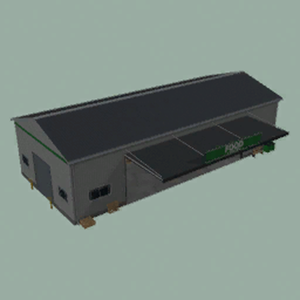

# ModHub upload: Logistics Hub

What to enter in the GIANTS ModHub upload form for this mod. Each text box below has a copy button on GitHub.



**Mod Icon (512x512):** [`icon_512.png`](icon_512.png)

| Field | Value |
|-------|-------|
| Title English | Logistics Hub |
| Title German | Logistikzentrum |
| Title French | Logistics Hub |
| Version | `1` `5` `2` `0` |
| Author | DTM Mods, Fennell, PropaineX |
| Manufacturer | Lizard |
| Category 1 | Placeable > Production Sites |
| Category 2 | Placeable > Storages |
| Category 3 | Gameplay |

## Title English
```text
Logistics Hub
```

## Title German
```text
Logistikzentrum
```

## Title French
```text
Logistics Hub
```

## Description English
```text
Logistics Hub is a pallet hall that stores your products and sends them on. Drop pallets on the unload pad at the front, then choose per product whether it stays in storage, comes out as pallets at the pickup lanes at the back, is delivered to your other productions or is sold every full hour.

- Two hubs: Food & Drinks (green sign) and Textiles & Goods (blue sign)
- Up to 1,000,000 L of storage per product, racks with 84 pallet places that fill up with the stock
- Spawn goods: pick the product, the pallet (its own pallet, or 1,000 L / 5,000 L), the farm and how many
- Productions window (Right Shift + P): all your productions in one table, with schedules, auto-management and alerts
- Working roller doors, a daily report at 06:00 and an AutoDrive route when you place a hub
- Also takes the products of the FedMods packs, Beans & Alpacas and Highlands Fishing when those are loaded; no other mod is needed
- Pallets only: no bulk goods, field crops or bales
- Price: 50,000 per hub, no daily upkeep

Changelog 1.3.0.5:
- The 400 kg pallet weight cap now holds everywhere, also for pallets saved before the cap (e.g. the 775 kg buffalo butter pallet).
- Spawn goods and the pallet size setting offer the 1,000 L and 5,000 L sizes only at the hubs.
```

## Description German
```text
Das Logistikzentrum ist eine Palettenhalle, die deine Produkte lagert und weitergibt. Stell Paletten auf der Abladefläche vorne ab und wähle dann je Produkt, ob es im Lager bleibt, als Paletten an den Abholspuren hinten ausgegeben, an deine anderen Produktionen geliefert oder zu jeder vollen Stunde verkauft wird.

- Zwei Hallen: Lebensmittel und Getränke (grünes Schild) sowie Textilien und Waren (blaues Schild)
- Bis zu 1.000.000 L Lager pro Produkt, Regale mit 84 Palettenplätzen, die sich mit dem Bestand füllen
- Waren auslagern: Produkt, Palette (die eigene Palette des Produkts oder 1.000 L / 5.000 L), Hof und Anzahl wählen
- Produktionsfenster (Rechte Umschalttaste + P): alle deine Produktionen in einer Tabelle, mit Zeitplänen, automatischer Verwaltung und Hinweisen
- Rolltore zum Öffnen, ein Tagesbericht um 06:00 und eine AutoDrive-Route beim Platzieren
- Nimmt auch die Produkte der FedMods-Pakete, von Beans & Alpacas und Highlands Fishing an, wenn diese geladen sind; keine andere Mod nötig
- Nur Paletten: kein Schüttgut, keine Feldfrüchte, keine Ballen
- Preis: 50.000 je Halle, keine täglichen Unterhaltskosten

Changelog 1.3.0.5:
- Die Gewichtsgrenze von 400 kg pro Palette gilt jetzt überall, auch für Paletten, die vor der Grenze gespeichert wurden (z. B. die 775 kg schwere Büffelbutter-Palette).
- Waren auslagern und die Einstellung Palettengröße bieten die Größen 1.000 L und 5.000 L nur noch in den Logistikzentren an.
```

## Description French
```text
Logistics Hub est un hangar à palettes qui stocke vos produits et les redistribue. Déposez les palettes sur la zone de déchargement à l'avant, puis choisissez pour chaque produit s'il reste en stock, sort en palettes aux voies d'enlèvement à l'arrière, est livré à vos autres productions ou est vendu à chaque heure pleine.

- Deux hangars : Food & Drinks (panneau vert) et Textiles & Goods (panneau bleu)
- Jusqu'à 1 000 000 L de stockage par produit, des racks de 84 places qui se remplissent avec le stock
- Sortie de marchandises : choisissez le produit, la palette (sa propre palette, ou 1 000 L / 5 000 L), la ferme et le nombre
- Fenêtre des productions (Maj droite + P) : toutes vos productions dans un tableau, avec plannings, gestion automatique et alertes
- Portes roulantes qui s'ouvrent, rapport quotidien à 06:00 et route AutoDrive à la pose
- Accepte aussi les produits des packs FedMods, de Beans & Alpacas et de Highlands Fishing s'ils sont chargés ; aucun autre mod nécessaire
- Palettes uniquement : pas de vrac, de récoltes ni de balles
- Prix : 50 000 par hangar, pas de frais d'entretien quotidiens

Changelog 1.3.0.5 :
- La limite de 400 kg par palette s'applique désormais partout, aussi aux palettes sauvegardées avant la limite (p. ex. la palette de beurre de bufflonne de 775 kg).
- La sortie de marchandises et le réglage de taille de palette ne proposent les tailles 1 000 L et 5 000 L que dans les hangars.
```

## Before uploading

- The icon was upscaled from 256 px; a sharper 512 px icon would look better on ModHub.
- The same build ships under two zip names (`FS25_LogisticsHub.zip` and `FS25_PalletDepot.zip`, the old name kept so existing savegames keep their hubs). ModHub takes one file; decide which name to upload.
- Translations in the mod itself: English and German only, no French (title, description, shop and menu texts).
