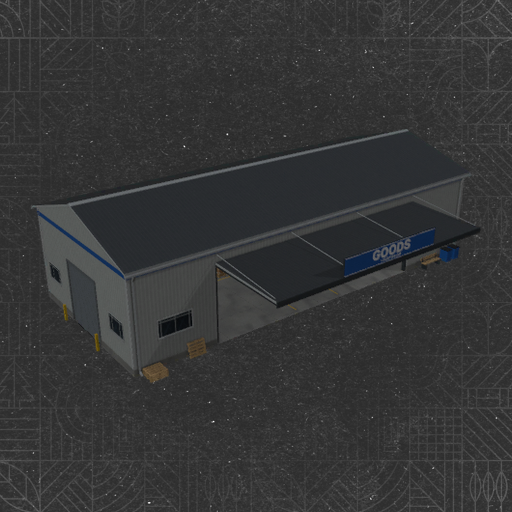

# ModHub upload: Logistics Hub

What to enter in the GIANTS ModHub upload form for this mod. Each text box below has a copy button on GitHub.



**Mod Icon (512x512):** [`icon_512.png`](icon_512.png)

| Field | Value |
|-------|-------|
| Title English | Logistics Hub |
| Title German | Logistikzentrum |
| Title French | Logistics Hub |
| Version | `1` `5` `2` `0` |
| Author | DTM Mods, Fennell, PropaineX |
| Manufacturer | Lizard |
| Category 1 | Placeable > Production Sites |
| Category 2 | Placeable > Storages |
| Category 3 | Gameplay |

## Title English
```text
Logistics Hub
```

## Title German
```text
Logistikzentrum
```

## Title French
```text
Logistics Hub
```

## Description English
```text

Logistics Hub: Food & Drinks
Category: Production Sites
Price: $50,000
Monthly upkeep: none

Logistics Hub: Textiles & Goods
Category: Production Sites
Price: $50,000
Monthly upkeep: none

Own pallet (1,000 L)
Category: Pallets (not sold in the shop: the hubs put goods out on them)
Price: $600
Capacity: 1,000 l

Own pallet (2,500 L)
Category: Pallets (not sold in the shop: the hubs put goods out on them)
Price: $1,000
Capacity: 2,500 l

Own pallet (5,000 L)
Category: Pallets (not sold in the shop: the hubs put goods out on them)
Price: $1,500
Capacity: 5,000 l

Hotkeys: Right Shift + P opens the productions window. Controller: none by default, set one under Settings > Controls.

A pallet hall that stores your products and sends them on: drop pallets on the unload pad at the front, then choose per product whether it stays in storage, comes out as pallets at the pickup lanes at the back, is delivered to your other productions or is sold every full hour.

Two buildings, each with its own storage of up to 1,000,000 L per product:
- Logistics Hub: Food & Drinks (green sign)
- Logistics Hub: Textiles & Goods (blue sign)
Both also take the products of the FedMods packs, of the Beans & Alpacas pack (bananas, coffee, alpaca goods, paint) and of the Highlands Fishing pack (fish, onion products, roof shingles) when those are loaded; without them they offer the base-game products. No other mod is needed.

Pallets only: bulk goods, field crops and bales are not accepted.

Sign lettering set in Inter (SIL Open Font License).
```

## Description German
```text

Logistikzentrum: Lebensmittel und Getränke
Kategorie: Produktionsstätten
Preis: 50.000 €
Monatliche Unterhaltskosten: keine

Logistikzentrum: Textilien und Waren
Kategorie: Produktionsstätten
Preis: 50.000 €
Monatliche Unterhaltskosten: keine

Eigene Palette (1.000 L)
Shopkategorie: Paletten (nicht im Shop: die Logistikzentren lagern Waren darauf aus)
Preis: 600 €
Kapazität: 1.000 l

Eigene Palette (2.500 L)
Shopkategorie: Paletten (nicht im Shop: die Logistikzentren lagern Waren darauf aus)
Preis: 1.000 €
Kapazität: 2.500 l

Eigene Palette (5.000 L)
Shopkategorie: Paletten (nicht im Shop: die Logistikzentren lagern Waren darauf aus)
Preis: 1.500 €
Kapazität: 5.000 l

Tastenkombinationen: Rechte Umschalttaste + P öffnet das Produktionsfenster. Controller: standardmäßig keine, unter Einstellungen > Steuerung belegen.

Eine Palettenhalle, die deine Produkte lagert und weitergibt: Paletten auf der Abladefläche vorne abstellen und dann je Produkt wählen, ob es im Lager bleibt, als Paletten an den Abholspuren hinten ausgegeben, an deine anderen Produktionen geliefert oder zu jeder vollen Stunde verkauft wird.

Zwei Hallen mit eigenem Lager von bis zu 1.000.000 L pro Produkt:
- Logistikzentrum: Lebensmittel und Getränke (grünes Schild)
- Logistikzentrum: Textilien und Waren (blaues Schild)
Beide nehmen auch die Produkte der FedMods-Pakete, des Beans & Alpacas Packs (Bananen, Kaffee, Alpaka-Waren, Farbe) und des Highlands Fishing Packs (Fisch, Zwiebelprodukte, Dachschindeln) an, wenn diese geladen sind; ohne sie bieten sie die Produkte des Grundspiels. Keine andere Mod nötig.

Nur Paletten: Schüttgut, Feldfrüchte und Ballen werden nicht angenommen.

Schild-Schrift: Inter (SIL Open Font License).
```

## Description French
```text
Logistics Hub: Food & Drinks
Catégorie : Sites de production
Prix : 50 000 €
Entretien mensuel : aucun

Logistics Hub: Textiles & Goods
Catégorie : Sites de production
Prix : 50 000 €
Entretien mensuel : aucun

Palette propre (1 000 L)
Catégorie : Palettes (pas en vente dans la boutique : les hangars y sortent les marchandises)
Prix : 600 €
Capacité : 1 000 l

Palette propre (2 500 L)
Catégorie : Palettes (pas en vente dans la boutique : les hangars y sortent les marchandises)
Prix : 1 000 €
Capacité : 2 500 l

Palette propre (5 000 L)
Catégorie : Palettes (pas en vente dans la boutique : les hangars y sortent les marchandises)
Prix : 1 500 €
Capacité : 5 000 l

Raccourcis : Maj droite + P ouvre la fenêtre des productions. Manette : aucun par défaut, à attribuer dans Paramètres > Commandes.

Un hangar à palettes qui stocke vos produits et les redistribue : déposez les palettes sur la zone de déchargement à l'avant, puis choisissez pour chaque produit s'il reste en stock, sort en palettes aux voies d'enlèvement à l'arrière, est livré à vos autres productions ou est vendu à chaque heure pleine.

Deux hangars, chacun avec son propre stockage jusqu'à 1 000 000 L par produit :
- Logistics Hub: Food & Drinks (panneau vert)
- Logistics Hub: Textiles & Goods (panneau bleu)
Les deux acceptent aussi les produits des packs FedMods, du Beans & Alpacas Pack (bananes, café, produits d'alpaga, peinture) et du Highlands Fishing Pack (poisson, produits à base d'oignon, bardeaux de toiture) quand ils sont chargés ; sans eux, ils proposent les produits du jeu de base. Aucun autre mod n'est nécessaire.

Palettes uniquement : le vrac, les récoltes des champs et les balles ne sont pas acceptés.

Lettrage des panneaux en Inter (SIL Open Font License).
```

## Before uploading

- Screenshots for the upload: [`modhub/screenshots/`](screenshots) (1600x900, unedited in-game shots, `1.jpg` first).
- The icon was upscaled from 256 px; a sharper 512 px icon would look better on ModHub.
- The same build ships under two zip names (`FS25_LogisticsHub.zip` and `FS25_PalletDepot.zip`, the old name kept so existing savegames keep their hubs). ModHub takes one file; decide which name to upload.
- Translations in the mod itself: English and German only, no French (title, description, shop and menu texts).
